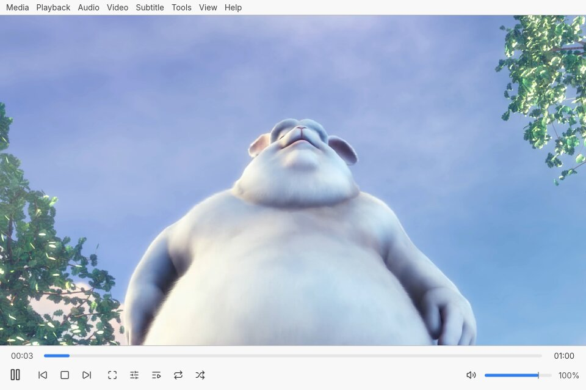

# VibeLC: a lightweight VLC-like video player

<p align="center">
  
  <br><sub>Big Buck Bunny © Blender Foundation, CC BY 3.0</sub>
</p>

For Linux and Windows, with the classic desktop layout: menu bar,
video, seek bar and controls, and an optional playlist panel. Playback is libmpv (FFmpeg
decoding, hardware decoding, libass subtitles); VibeLC is the window, controls, playlist,
dialogs and settings, written in Rust with egui.

It is built to stay light on old machines:

- The graphics card decodes every format it supports among H.264, HEVC, VP8, VP9, AV1, VC-1,
  WMV 9 and MPEG-2, and its frames go straight into the window without a copy back to memory:
  VA-API on Intel and AMD and NVDEC on NVIDIA under Linux, D3D11 on every card under Windows,
  where VibeLC draws with Direct3D 11 (a flip-model swap chain, as VLC does). What the card
  can't decode, FFmpeg and dav1d decode on the processor.
- Frames decoded on the processor are written straight into graphics memory when the driver
  maps it cached (VibeLC tests this at start), and otherwise uploaded through pixel buffers.
- The interface is laid out again only when something visible changes; a new video frame reuses
  the last layout, and nothing is drawn at all while paused.
- Scaling is bilinear by default.

`RESULTS.md` compares it with VLC on a 2014 desktop under Linux and on a 2024 laptop under Windows.

## Install

`vibelc-1.0.1.zip` holds everything in one `VibeLC` folder: the Windows program, the Linux
package, and in `source` this project with its git history. Both builds are standalone: they
carry their own libmpv and FFmpeg.

- **Linux** (Ubuntu 20.04 or newer, Debian 11 or newer): unzip it, then
  `sudo apt install ./VibeLC/vibelc_1.0.1_amd64.deb`.
  It adds VibeLC to the applications menu and to "Open With" for video and audio files, and
  installs the VA-API drivers for hardware decoding if they are missing. NVIDIA cards need the
  proprietary driver for NVDEC.
- **Windows** (10 or 11, 64-bit): unzip it anywhere and run `VibeLC\vibelc.exe`. Keep
  `libmpv-2.dll` and `vulkan-1.dll` next to it.

## Use

Open files with Ctrl+O, drop files or folders on the window, or pass them on the command line
(`vibelc --help` lists the options). Files opened while VibeLC runs go to the open window.
Right-click the video for the full menu; double-click toggles fullscreen.

| Keys | Action |
|---|---|
| Space | play or pause |
| F, F11, double-click / Esc | fullscreen / leave fullscreen |
| Left, Right (Shift: 3 s, Ctrl: 1 min, Ctrl+Alt: 5 min) | seek 10 s |
| Up, Down, mouse wheel / M | volume / mute |
| N, P / S | next, previous / stop |
| [, ], = | slower, faster, normal speed |
| B, V | next audio or subtitle track |
| Ctrl+L, Ctrl+H | playlist, minimal interface |
| Ctrl+I, Ctrl+E, Ctrl+P | media information, effects, preferences |
| F1 | all shortcuts |

Settings and the log (`vibelc.log`) are in `~/.config/vibelc` on Linux and
`%APPDATA%\VibeLC\config` on Windows.

If the picture is wrong or VibeLC crashes on an old graphics driver, start it with `--safe`
(software decoding, fastest rendering); a second thing to try is `--gl=glx` on Linux and
`--gl=wgl` (the driver's OpenGL instead of Direct3D 11) on Windows.

## Build

VibeLC needs Rust 1.95 or newer. libmpv is loaded at run time, so building needs no C libraries.
Release builds are optimized as a whole program (fat LTO, one code generation unit) for any
x86-64 processor: the heavy code, in FFmpeg and dav1d, picks its SIMD level at run time.

```sh
cargo build --release
cargo test        # integration tests skip without libmpv; VIBELC_REQUIRE_LIBMPV=1 makes them fail
```

To run from source, VibeLC needs a libmpv: the distribution's (`sudo apt install libmpv2`, or
`libmpv1` on Ubuntu 22.04) or the one `packaging/linux/build-libmpv.sh` builds, which is used
with `VIBELC_LIBMPV=target/linux/prefix/lib/libmpv.so.2`.

Packages (Docker and `cargo install cargo-about --locked --features cli` needed):

- `packaging/linux/build-deb.sh` builds libmpv (mpv 0.42 with FFmpeg 8.1, dav1d, libplacebo,
  libass and LuaJIT, all linked in) and vibelc on Ubuntu 20.04, then the .deb. The first run
  takes about 15 minutes. `packaging/linux/test-deb.sh ubuntu:24.04` installs the .deb in a
  clean container and checks that it plays.
- `packaging/windows/build-zip.sh` makes the zip. It runs `build-deb.sh`, cross-compiles
  `vibelc.exe`, and packs it with `libmpv-2.dll` from
  [shinchiro's mpv builds](https://github.com/shinchiro/mpv-winbuild-cmake), the Vulkan loader
  that DLL links, the .deb, and a copy of the project with its git history (without `target/`).

On Windows, `cargo build --release` works with the MSVC toolchain (Rust 1.95 or newer). To run
the result, put `libmpv-2.dll` and `vulkan-1.dll` next to
`target\release\vibelc.exe`, or set `VIBELC_LIBMPV` to the path of `libmpv-2.dll`.

## Windows test checklist

1. Unzip and start `vibelc.exe`: the window shows the logo and "Drop media here".
2. Open a 1080p H.264 file. View > Status Bar should say "Hardware decoding (d3d11va)", with
   few or no dropped frames ("(d3d11va-copy)" means Direct3D 11 failed and VibeLC fell back
   to OpenGL; the log says why).
3. Fullscreen (double-click): the controls fade out after 2.5 s with the mouse still; Esc leaves.
4. Seek by clicking and dragging the bar; volume with the wheel and Up/Down.
5. A file with subtitles: they show; V and B switch subtitle and audio tracks; dropping an .srt
   adds it.
6. Drop a folder: the playlist fills with titles and durations; double-click plays an entry.
7. With VibeLC open, double-click another video in Explorer: it plays in the same window.
8. During playback the screen does not dim or sleep.
9. Close and reopen: volume, window size and theme are kept, and a part-watched file offers to
   continue where it stopped.
10. If anything fails, run `vibelc.exe --safe` once, and send
    `%APPDATA%\VibeLC\config\vibelc.log`.

## Licence

GPL-3.0-or-later (`LICENSE`). Third-party components and their licences are in
`THIRD-PARTY.md`, generated into each package.

Fully vibe coded.
